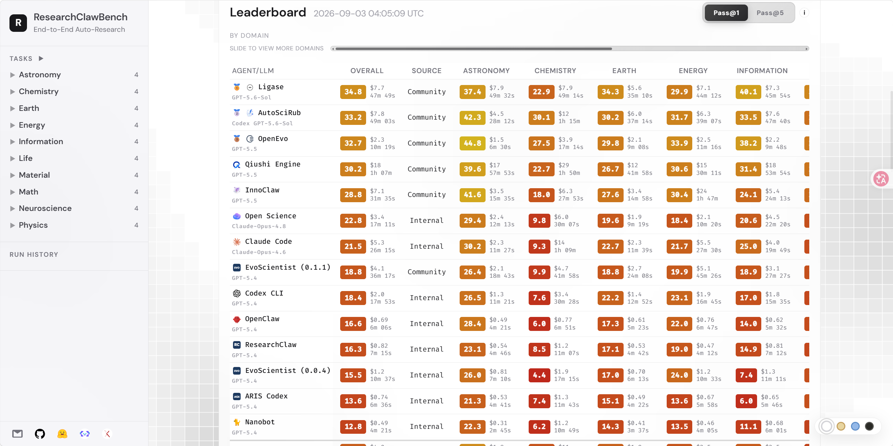

<p align="center">
  
</p>

<h1 align="center">AutoSciRub</h1>

<p align="center">
  Learning to Evaluate Before Improving: Automatic Rubric Induction for Automatic Research Agents
</p>

<p align="center">
  Turn underspecified scientific research instructions into executable rubrics for guided execution, verification, and targeted revision.
</p>

<p align="center">
  <a href="https://arxiv.org/abs/2608.31076"></a>
  <a href="https://huggingface.co/papers/2608.31076"></a>
  
  
  <a href="LICENSE"></a>
</p>

AutoSciRub is a plugin bundle for AI research agents. It packages the workflow from the paper
[Learning to Evaluate Before Improving: Automatic Rubric Induction for Automatic Research Agents](https://arxiv.org/abs/2608.31076) as installable skills
that work across Codex, Claude Code, and OpenClaw.

## News

  **2026-09-03** — AutoSciRub achieved a higher score on the latest
  [ResearchClawBench](https://github.com/InternScience/ResearchClawBench)
  [leaderboard](https://internscience.github.io/ResearchClawBench-Home/), reaching
  **33.2 Pass@1** with Codex + GPT-5.6-Sol.

  <p align="center">
    
  </p>

  <p align="center">
    <em>ResearchClawBench leaderboard snapshot recorded on 2026-09-03 04:05 UTC.</em>
  </p>

  **2026-08-13** — AutoSciRub achieved **2nd place** on the
  [ResearchClawBench](https://github.com/InternScience/ResearchClawBench)
  [leaderboard](https://internscience.github.io/ResearchClawBench-Home/), with a
  **25.1 Pass@1** score using Codex + GPT-5.6-Terra.

## Highlights

- **Rubric induction at inference time** — builds a goal skeleton, grounds it in literature, and
  adapts to the data actually available in the task.
- **Executable rubric contract** — each criterion names the required analysis, evidence artifacts,
  and satisfaction condition.
- **Criterion-level verification** — verification reports which specific criteria are unmet and why,
  instead of a single score.
- **Targeted revision loop** — revisions are driven by failed criteria, not vague feedback.
- **Configurable retrieval backends** — built-in support for arXiv, OpenAlex, Semantic Scholar,
  and Tavily through a single script and a shared YAML config.
- **Framework-agnostic** — no fixed paths, no fixed Python environments, no hidden benchmark
  assumptions. Works in any research project directory.

## Quick Start

Install the plugin for your agent, then open any research project and trigger AutoSciRub.

### 1. Install

```bash
git clone https://github.com/zjunlp/AutoSciRub.git
cd AutoSciRub
./scripts/install.sh codex      # or: claude, openclaw
```

### 2. Start from any project directory

```bash
cd my-research-project
```

### 3. Try one of these prompts

Full workflow:

> Use AutoSciRub end-to-end on this research task: induce the rubric, guide execution, verify
> the result criterion by criterion, and run targeted revision rounds until the rubric is
> satisfied or the revision budget is reached.

Rubric only:

> Use AutoSciRub to induce an executable rubric for this task. Stop after criterion synthesis.

Verification only:

> Verify this report against the AutoSciRub executable rubric and write a verification report.

AutoSciRub stores its state in `.autoscirub/` inside the current project.

## Installation

### Codex

```bash
./scripts/install.sh codex
```

Or manually:

```bash
codex plugin marketplace add /path/to/AutoSciRub/.agents/plugins
codex plugin add autoscirub@autoscirub-local
```

### Claude Code

```bash
./scripts/install.sh claude
```

Or manually:

```bash
claude plugin marketplace add /path/to/AutoSciRub
claude plugin install autoscirub@autoscirub-local
```

### OpenClaw

```bash
./scripts/install.sh openclaw
```

OpenClaw falls back to installing individual skills if the plugin marketplace path is not
accepted.

## Workflow

AutoSciRub runs in six stages, each with its own skill and state file.

1. **Rubric Skeleton Induction** — extract atomic scientific goals from the instruction.
2. **Scientific Literature Grounding** — ground each goal in methods, metrics, baselines, and
   evidence forms from the literature.
3. **Task-Data Exploration** — profile the visible data, tools, and constraints to judge
   feasibility.
4. **Criterion Synthesis** — combine goals, literature, and data into an executable rubric.
5. **Criterion-Level Verification** — check the generated artifact against each criterion.
6. **Targeted Revision** — address failed criteria and produce an updated artifact.

The top-level `autoscirub` skill orchestrates the full pipeline.

## Layout

```text
AutoSciRub/
├── plugins/autoscirub/
│   ├── .codex-plugin/plugin.json
│   ├── .claude-plugin/plugin.json
│   ├── skills/
│   │   ├── autoscirub/
│   │   ├── rubric-skeleton-induction/
│   │   ├── scientific-literature-grounding/
│   │   ├── task-data-exploration/
│   │   ├── criterion-synthesis/
│   │   ├── criterion-level-verification/
│   │   ├── targeted-revision/
│   │   └── mineru-pdf-to-markdown/
│   └── schemas/
├── config/
│   ├── sources.example.yaml
│   └── sources.schema.json
├── scripts/
├── .agents/plugins/marketplace.json
├── .claude-plugin/marketplace.json
├── LICENSE
└── README.md
```

## Configuration

Copy the example config into your project to customize retrieval sources, limits, and exclusions:

```bash
cp config/sources.example.yaml .autoscirub/config.yaml
```

The bundled retrieval script reads API keys only from environment variables named in the config:

- `OPENALEX_EMAIL` — optional, for the OpenAlex polite pool
- `SEMANTIC_SCHOLAR_API_KEY` — optional, raises rate limits
- `TAVILY_API_KEY` — required to enable Tavily
- `MINERU_API_TOKEN` — required for high-accuracy MinerU PDF parsing

arXiv is always available without a key.

The example config works without extra Python packages. AutoSciRub uses PyYAML when it is available; if you use advanced YAML features such as anchors or lists of mappings, install it with `python3 -m pip install PyYAML`.

Validate a config without running retrieval:

```bash
python3 plugins/autoscirub/skills/scientific-literature-grounding/scripts/retrieve_literature.py \
  --config .autoscirub/config.yaml \
  --validate-config
```

Invalid or missing configuration now stops immediately with a clear error instead of silently falling back to different retrieval settings. The machine-readable configuration contract is in `config/sources.schema.json`.

## Validation

Validate the plugin package and all skills:

```bash
python3 scripts/validate.py
```

This checks:

- plugin manifest shape
- marketplace entries
- skill frontmatter and naming
- no hard-coded absolute paths or legacy benchmark names
- JSON schema files are valid

## State Contract

AutoSciRub writes all framework state into `.autoscirub/` in the current project by default.
Override with the `AUTOSCIRUB_STATE_DIR` environment variable.

Key files:

| File | Purpose |
| --- | --- |
| `run_manifest.json` | run metadata |
| `rubric_skeleton.json` | instruction-derived goals |
| `literature_sources.json` | normalized retrieval results |
| `literature_grounding.json` | per-goal methods, metrics, evidence forms |
| `task_data_profile.json` | visible data and feasibility notes |
| `executable_rubric.json` | synthesized verification criteria |
| `verification_report.json` | per-criterion pass/fail and gaps |
| `revisions/round-NNN/` | revision-round artifacts |

JSON schemas live in `plugins/autoscirub/schemas/`.

## Citation

If you use AutoSciRub in your research, please cite:

```bibtex
@article{autoscirub,
  title={Learning to Evaluate Before Improving: Automatic Rubric Induction for Automatic Research Agents},
  author={Wang, Xuehai and Qin, Haowei and Liu, Tongxin and Li, Junkai and Xu, Buqiang and others},
  journal={arXiv preprint},
  year={2026}
}
```

Replace the entry with the final citation once the paper is published.

## License

MIT. See [LICENSE](LICENSE).
